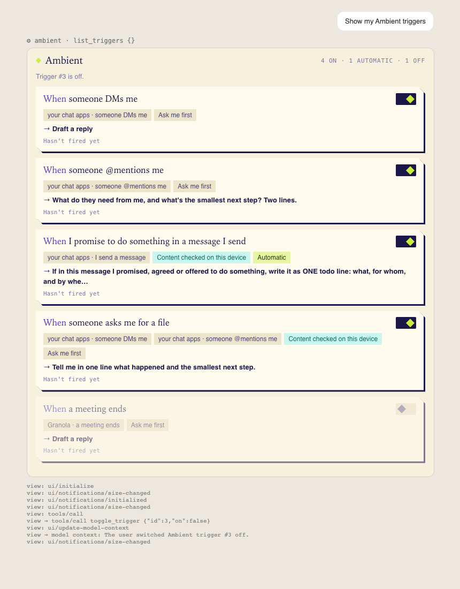
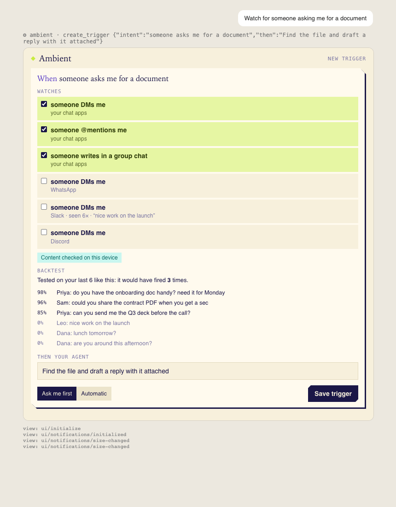

# Ambient beside Claude and Codex

Two thin clients over Ambient's local API (`http://127.0.0.1:8787`). Both do two things only: show your
triggers, and define a new one from one sentence. Nothing else (no capture controls, no Veil).

| | What it is | Where |
|---|---|---|
| **MCP server** | Tools `list_triggers`, `create_trigger`, `toggle_trigger`, `recent_moments`, with an MCP App view (`ui://ambient/triggers`) that hosts which render MCP Apps draw inline | `engine/mcp_app.py`; served by the app at `/mcp`, or over stdio by `integrations/mcp/ambient_mcp.py` |
| **Claude Code mod** | A pane beside the chat: the current triggers with a switch each, and one "Watch for…" field | `integrations/claude-code-mod/` (see its README) |

 

## Install the MCP server

Two ways in. Use HTTP where the host takes a local URL (no checkout needed, the app serves it); use stdio
for Claude Desktop, whose config file starts local servers as commands. The stdio server is standard-library
Python: any `python3`, no venv. Set `AMBIENT_URL` (or pass `--url`) if the app is not on 8787.

**Claude Code**

```
claude mcp add --transport http ambient http://127.0.0.1:8787/mcp
# or, stdio:
claude mcp add ambient -- python3 /path/to/ambient/integrations/mcp/ambient_mcp.py
```

**Codex** (CLI, IDE extension and the ChatGPT desktop app share `~/.codex/config.toml`)

```
codex mcp add ambient --url http://127.0.0.1:8787/mcp
```
or by hand:
```toml
[mcp_servers.ambient]
url = "http://127.0.0.1:8787/mcp"

# or, stdio:
# [mcp_servers.ambient]
# command = "python3"
# args = ["/path/to/ambient/integrations/mcp/ambient_mcp.py"]
```

**Claude Desktop** (`~/Library/Application Support/Claude/claude_desktop_config.json`, then restart it)

```json
{
  "mcpServers": {
    "ambient": {
      "command": "python3",
      "args": ["/path/to/ambient/integrations/mcp/ambient_mcp.py"]
    }
  }
}
```

A custom connector added by URL on claude.ai or in the desktop app does not work: Anthropic's servers make
that connection, and they cannot reach `127.0.0.1` on your machine (by design, neither can anyone else).

## What each host shows

MCP Apps is the official `io.modelcontextprotocol/ui` extension (spec dated 2026-01-26). A host that supports
it renders the view; every other host gets the same result as text, which is written to read well on its own.

| Host | Ambient's tools | The inline view |
|---|---|---|
| Claude Desktop (chat, and its Code tab) | yes | yes; it asks once before showing a server's app |
| Claude Code in a terminal | yes | no, text only. Use the mod for a live pane |
| Codex CLI | yes | no, text only |
| Codex in the ChatGPT desktop app | yes | reported for recent builds; not verified here |
| ChatGPT web, claude.ai web | no: they reach MCP servers from the cloud, which cannot reach a local app |

## Safety

- `create_trigger` saves nothing on its own. It returns the draft (which kinds of event it would watch, and a
  backtest on recent events). It saves when the person presses **Save trigger** in the view, or when the model
  calls it again with `confirm=true`; the tool description tells the model to do that only after the person
  agreed. New triggers are **Ask me first**; automatic is a choice in the view (or `automatic=true`).
- The view has no network access of its own (empty CSP). Every action goes back through the host as a tool
  call, so the host's own approval rules apply to it.
- The API's local-only rules are unchanged: the stdio server talks to it like any local tool (local Host, no
  Origin, `X-Ambient: 1` on writes). `/mcp` is still refused to web pages.

## For developers

- One client interface (`Client` in `engine/mcp_app.py`) is all the tools touch: `HttpClient` for the stdio
  server, `LocalClient` for the engine's own `/mcp`. The mod has its own one-file client,
  `integrations/claude-code-mod/hooks/ambient.ts`. When the trigger engine changes shape, these change and
  nothing else.
- Tests: `tests/test_mcp_app.py` (`HF_HUB_OFFLINE=1 AMBIENT_AGENT_CMD=cat uv run pytest -q`), and
  `claude plugin test integrations/claude-code-mod` for the mod.
- Try it against a scratch engine, never the app you use:

  ```
  AMBIENT_AGENT_CMD=cat uv run python -m engine --mode regular@18093 --set listen_host=127.0.0.1 \
      --set ambient_ui=18799 --set ambient_db=/tmp/scratch.db
  npx @modelcontextprotocol/inspector --cli python3 integrations/mcp/ambient_mcp.py --url http://127.0.0.1:18799 --method tools/list
  npx @modelcontextprotocol/inspector --cli http://127.0.0.1:18799/mcp --transport http --method tools/call --tool-name list_triggers
  ```
