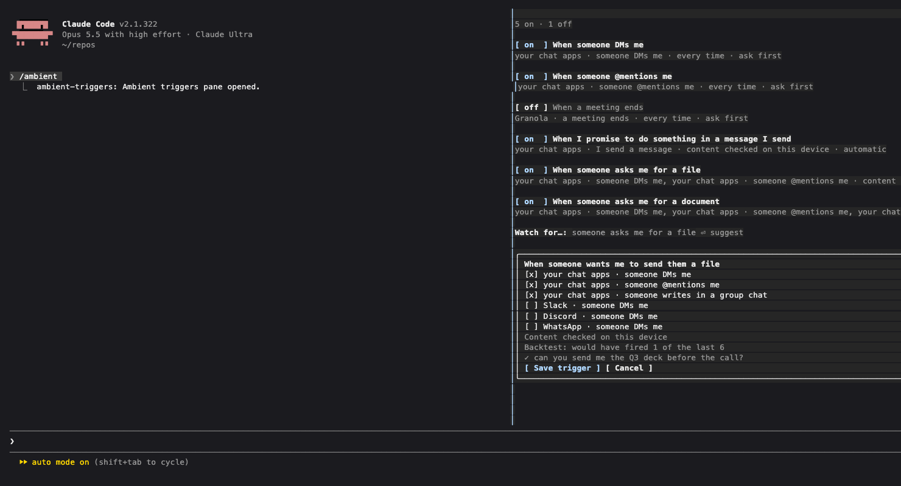

# Ambient triggers, beside the chat in Claude Code

A Claude Code mod: a pane next to the conversation that shows Ambient's triggers (refreshed every 15 seconds
while the pane is on screen), a switch on each, and one field, **Watch for…**. Type a sentence ("someone asks
me for a file"), press Enter, and the pane shows which kinds of event Ambient thinks you mean and how often it
would have fired lately. Tick or untick kinds, then **Save trigger**. Nothing is saved before that, and new
triggers wait for you (Ask me first).



## Install

Needs the Ambient app running (its API on `http://127.0.0.1:8787`).

Try it for one session:

```
claude --plugin-dir /path/to/ambient/integrations/claude-code-mod
```

Keep it: add this folder as a local marketplace and install from it, or name it in `CLAUDE_CODE_PLUGIN_DIRS`.

```
export CLAUDE_CODE_PLUGIN_DIRS=/path/to/ambient/integrations/claude-code-mod
```

The pane opens by itself once the terminal is wide enough (about 144 columns); `/ambient` opens it at any
width and puts the keyboard in it: Tab moves between switches and the field, Enter presses, Esc returns to
the prompt. With a mouse, click.

Another address: set `AMBIENT_URL=http://127.0.0.1:18799` in the environment, or the plugin's
`ambientUrl` option in `/config`.

## Files

| File | What |
|---|---|
| `hooks/register.tsx` | the pane, the `/ambient` command, polling |
| `hooks/ambient.ts` | the only code that knows Ambient's API (`/api/triggers`, `/suggest`, `/preview`) |
| `types/index.d.ts` | the values the pane keeps in session state |
| `hooks/register.test.tsx` | `claude plugin test .` against a stand-in API |

The MCP server (for Claude Desktop and Codex as well) is described in `docs/integrations.md`.
